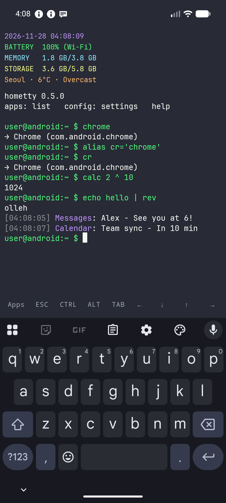

# hometty

Launch apps, run shell commands, and read notifications from your Android home launcher.

<p align="center">
  
</p>

- Open apps by name or package name, with tab completion
- Notifications show up in the terminal
- BusyBox ash with pipes, redirection and history
- 361 bundled commands, including `grep`, `find`, `wget` and `vi`
- Notes, RSS feeds, weather and status lines

Inspired by [T-UI Linux CLI Launcher](https://github.com/fandreuz/TUI-ConsoleLauncher).

## Usage

Install hometty from [Google Play](https://play.google.com/store/apps/details?id=io.luftaquila.hometty) (Android 10+) and set it as your home app.

Type `help` to see the commands and `config` to change settings.

See the [user guide](https://luftaquila.github.io/hometty/) for setup, commands, and customization.

```sh
apps -al
chrome
alias work='apps launch ${1}'
calc 2 * 3
weather
```

## Building

Requires JDK 26, Python 3.12+, `patch`, and the Android SDK with NDK 28.2.13676358 and CMake 3.22.1.

```sh
./gradlew :launcher:assembleDebug                  # debug APK
./gradlew :core:test :launcher:testDebugUnitTest   # unit tests
./gradlew :launcher:connectedDebugAndroidTest      # device tests
```

The first build downloads and compiles BusyBox using the pinned [build recipe](busybox/README.md).

Release downloads include the matching BusyBox source archive with patched sources,
licenses and offline build instructions.
