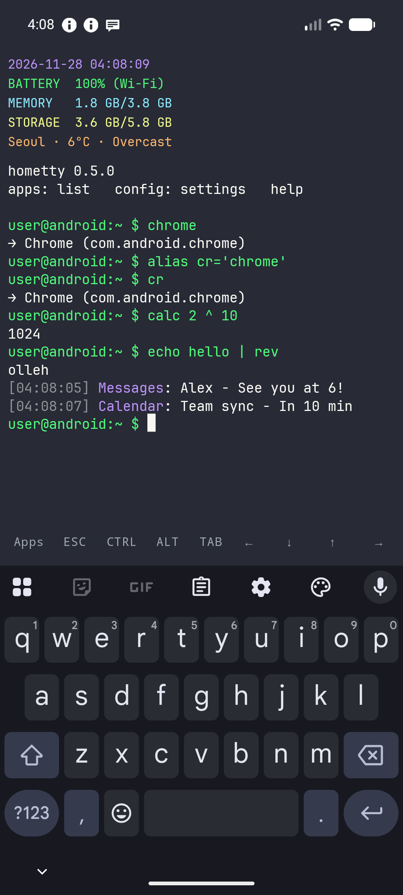

# hometty user guide

Launch apps, run shell commands, and read notifications in one terminal.

[Getting started](./getting-started.md) covers installation, permissions, and your first commands.

- [Open apps and create aliases](./apps-and-aliases.md)
- [Use the terminal](./terminal.md)
- [Choose a theme and font](./appearance.md)
- [Customize status lines](./status-lines.md)
- [Read notifications](./notifications.md)
- [Set up weather and RSS](./tools.md)

Type `help` to list commands or `config` to open settings.

[Google Play](https://play.google.com/store/apps/details?id=io.luftaquila.hometty)

[GitHub](https://github.com/luftaquila/hometty)

## Find a setting or command

- [Commands](./reference/commands.md) — syntax and options
- [Settings](./reference/settings.md) — keys, defaults, and allowed values
- [Troubleshooting & backup](./troubleshooting.md) — common problems and restoring your data

Inspired by [T-UI Linux CLI Launcher](https://github.com/fandreuz/TUI-ConsoleLauncher).
